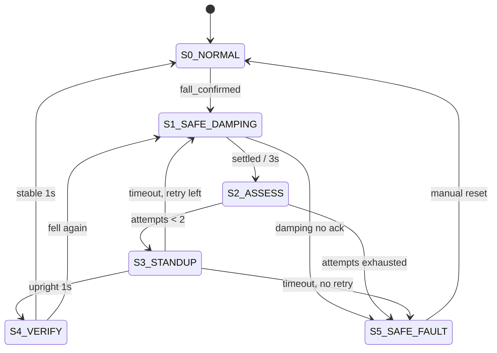

# Doggie 总体计划

> 版本：v0.1（2026-11-19）
> 任务：Lite3 恢复运控 —— 摔倒检测与恢复决策（状态机触发与起身动作调用）
> 目标：**总分 ≥90**；检测、恢复流程、失败处理、参数依据四项按优秀档设计；起身项按平台可恢复包络**保 6 争 8–9**（原因见 `docs/08-feasibility.md`）。

---

## 1. 问题拆解

任务书把任务二压缩成两个问题：

1. **什么迹象可以判定机器人已经摔倒？**
2. **判定之后，按什么顺序、在什么条件下切换状态？**

因此本项目的核心不是「发明恢复算法」，而是一个**可解释、可复现、可标定的决策层**：

```
传感器数据 ──► 摔倒判定 ──► 恢复状态机 ──► 调用平台动作
                 │              │
                 │              ├─ 安全状态（JointDamping）
                 │              ├─ 起身（StandUp）
                 │              └─ 失败/超时 → 安全状态 + 提示
                 └─ 判定依据、阈值、回差、驻留时间
```

平台已有的 `Idle / StandUp / RLControl / JointDamping` 状态与站立轨迹直接复用；我们负责「何时切、切到哪、失败了怎么办」。

---

## 2. 技术路线

### 2.1 为什么用 MuJoCo

| 方案 | 结论 | 理由 |
|---|---|---|
| **MuJoCo（选用）** | ✅ | 轻量（数百 MB）、CPU 可跑、接触物理稳定、易做姿态注入与批量测试；官方 Lite3 仓库本身支持 MuJoCo |
| PyBullet | 备选 | 官方也支持，但接触与渲染质量不如 MuJoCo |
| Gazebo | 不选 | 需要完整 ROS2/URDF 链路，搭建成本高，对「摔倒」这种强接触场景调参麻烦 |
| Isaac Sim / Lab | 不选 | 体积大、驱动要求高，本机 12 GB 显存和磁盘都紧张，且任务不需要 RL 训练 |

本机配置（Ultra 9 275HX / 30 GB / RTX 5070 Ti 12 GB / 约 72 GB 可用）跑 MuJoCo 绰绰有余，**不需要租云服务器**。

### 2.2 模型与资产来源

- **MJCF 模型**：DeepRobotics 官方 Lite3 模型（BSD-3-Clause，`models/lite3/LICENSE.txt`），含 12 个力矩电机、IMU site、碰撞体。
- **行走策略**：官方 `Lite3_rl_deploy` 的 `policy.onnx`（45 维观测 / 12 维动作，推理频率为物理步的 1/12），用于「行进中失稳」场景和误报测试。
- **站立轨迹**：按官方 `StandUpState` 的两阶段三次样条 + 逆运动学复刻，参数取自官方 `lite3_control_parameters.cpp`：
  - 预站立高度 `pre_height = 0.12 m`，最终站立高度 `stand_height = 0.33 m`；
  - 每段 `stand_duration = 2 s`，总时长 4 s；
  - 腿长 `thigh = 0.20 m`、`shank = 0.21 m`；
  - 站立关节角由 IK 计算，预站立姿态为 `[0, -1.35453, 2.54948] × 4`；
  - 关节增益 `kp = 100`、`kd = 2.5`（官方 swing leg 参数）。
- **状态机语义**：对齐官方 `StateMachine`：`Idle → StandUp → RLControl`，`JointDamping` 持续 3 s 后回 `Idle`，`LoseControlJudge()` 可强制切阻尼。

#### 官方代码的开放边界（答辩要讲清楚）

| 部分 | 是否开放 | 我们的用法 |
|---|---|---|
| `Lite3_rl_deploy/state_machine/*.hpp` | 开源（GitHub） | 只读参考：状态语义、站立轨迹、阻尼行为 |
| `interface/robot/simulation/mujoco_simulation.py` | 开源 | 参考 UDP 关节命令格式与仿真接口 |
| `Lite3_description/`（MJCF + meshes） | 开源（BSD-3） | 复用模型 |
| `policy/ppo/policy.onnx` | 开源 | 复用于小跑/失稳场景 |
| 机器人固件、量产 RL SDK、Jetson 部署包 | 闭源 | **不逆向**；只通过公开接口调用 |

> 结论：闭源的是“平台能力”的内部实现，而任务书明确要求“复用平台已有能力”。我们自研的是判定与决策层，仿真只需要复现**行为契约**（状态、接口、时序），不需要复现闭源代码。

### 2.3 两条落地路径

| 路径 | 用途 | 说明 |
|---|---|---|
| **A. 纯 Python + MuJoCo（主线）** | 算法开发、9+3 自动测试、标定 | 迭代快、可回归、可批量跑 |
| **B. ROS2 桥接（对接）** | 官方仿真 / 实机 | 复用官方话题 `/IMU_DATA`、`/JOINTS_DATA`、`/JOINTS_CMD`；决策层不依赖 ROS |

决策层写成**平台无关的纯逻辑**，仿真与实机只是两个 `Backend`。这样答辩时可以清楚区分「我们的决策」与「平台的能力」。

---

## 3. 系统架构

```
┌────────────────────────────────────────────────────────────┐
│                      RecoverySupervisor                     │
│                                                            │
│  ┌──────────────┐   fall_event   ┌──────────────────────┐  │
│  │ FallDetector │ ─────────────► │    RecoveryFSM       │  │
│  │              │                │                      │  │
│  │ 低通滤波      │                │ NORMAL               │  │
│  │ 姿态判据      │                │   ↓ 确认摔倒          │  │
│  │ 辅助确认      │                │ SAFE_DAMPING         │  │
│  │ 驻留 + 回差   │                │   ↓ 静止             │  │
│  │ 事件锁存      │                │ ASSESS               │  │
│  └──────────────┘                │   ↓ 可恢复/未超次数    │  │
│         ▲                        │ STANDUP → VERIFY     │  │
│         │                        │   ↓ 失败/超时         │  │
│         │                        │ SAFE_FAULT（锁存）    │  │
│         │                        └──────────┬───────────┘  │
│         │                                   │ commands     │
│  ┌──────┴───────────────────────────────────▼───────────┐  │
│  │                  RobotBackend (interface)            │  │
│  │  read(): imu_rpy, imu_omega, joint_pos, joint_vel,    │  │
│  │          contact, base_height(optional), timestamp    │  │
│  │  write(): set_mode(DAMPING/STANDUP/IDLE/RL),          │  │
│  │           set_velocity(vx, vy, wz), reset()           │  │
│  └───────────────┬───────────────────────┬──────────────┘  │
│                  │                       │                 │
│         ┌────────▼────────┐     ┌────────▼──────────────┐  │
│         │   SimBackend    │     │    Ros2Backend        │  │
│         │ MuJoCo + PD     │     │ /IMU_DATA /JOINTS_DATA│  │
│         │ 官方 MJCF/策略   │     │ /JOINTS_CMD 状态话题   │  │
│         └─────────────────┘     └───────────────────────┘  │
│                                                            │
│  ┌────────────────────┐  ┌──────────────────────────────┐  │
│  │   TrialLogger      │  │  StatusPublisher              │  │
│  │ CSV/JSONL + 时间戳  │  │ 终端 / ROS2 / 提示音（可选）    │  │
│  └────────────────────┘  └──────────────────────────────┘  │
└────────────────────────────────────────────────────────────┘
```

设计原则：

1. **决策与执行分离**：检测器只输出事件，FSM 只输出模式命令，Backend 负责具体下发。
2. **可观测**：每次状态切换都带时间戳、触发原因、关键传感器值。
3. **可测试**：核心逻辑不依赖 MuJoCo/ROS，可用回放数据做单元测试。
4. **默认安全**：任何异常（超时、通信丢失、传感器 NaN）都落到阻尼/待机，不自动反复尝试。

---

## 4. 摔倒判定设计

### 4.1 输入

| 信号 | 来源 | 用途 |
|---|---|---|
| roll / pitch | IMU（`GetImuRpy`） | 主判据 |
| 角速度 | IMU（`GetImuOmega`） | 动态确认、静止判断 |
| 关节角 | `GetJointPosition()` | 辅助确认（腿部是否收折/失去支撑） |
| 足端接触力 | `GetContactForce()` | 辅助确认（可选） |
| 躯干高度 | 仿真真值；实机由腿长 + 姿态估算 | 辅助确认（仿真中用于验证） |

### 4.2 判据

**第一层：姿态门限**

```
attitude_bad = |roll| > θ_roll  or  |pitch| > θ_pitch
```

初值 `θ_roll = θ_pitch = 50°`。理由：正常小跑在平地上 roll/pitch 包络约 ±25°，翻倒姿态静态倾角 >75°，50° 位于两者中间，左右各有 ≥25° 余量。

**第二层：持续确认（三选一，OR）**

1. 姿态超限持续 `T_dwell = 0.30 s`（防止腾空/急转瞬间误报）；
2. 躯干高度低于 `h_min = 0.20 m`（仿真）或四足接触力丢失（实机）；
3. 角速度在冲击后收敛到 `< 1.5 rad/s`，且姿态仍超限。

第一层 + 第二层同时满足 → `fall_confirmed`。

**快速通道**：倾角 > 75° 且持续 0.15 s 直接确认（侧翻/仰翻的典型静态姿态），用于保证时延 ≤2 s。

**回差（hysteresis）**：判定为摔倒后事件锁存；只有连续 `T_recover = 0.5 s` 满足 `|roll| < 35° 且 |pitch| < 35°` 才解除。回差用于避免在起身过程中姿态在阈值附近抖动导致重复触发。

**滤波**：一阶低通，截止频率 10 Hz；IMU 原始数据 200 Hz 以上。滤波只用于判定，不改变记录数据。

### 4.3 翻倒类型分类（用于报告与恢复策略）

| 类型 | 判据（静态） | 典型姿态 |
|---|---|---|
| 前翻 | `pitch > +60°` | 头朝下、腹部朝后 |
| 后翻 | `pitch < -60°` | 尾部着地、腹部朝前 |
| 左侧翻 | `roll > +60°` | 左侧身体着地 |
| 右侧翻 | `roll < -60°` | 右侧身体着地 |

分类不参与「是否摔倒」的判定，只用于记录和后续策略（例如某些姿态先侧移再起身）。

### 4.4 适用条件与失效场景（必须写进报告）

- 适用于静态/准静态翻倒，以及行走中失稳后的持续倒地；
- 短暂腾空、跳跃、被抱起时可能短暂超限，靠驻留时间过滤；
- 斜坡上姿态角包含坡度分量，阈值需按场地重新标定（本项目在 5° 斜坡上验证）；
- IMU 漂移或安装偏差会导致静态误差，需在直立状态下做零偏校准；
- 仅靠本体感知无法区分「摔倒」与「被卡住/被压住」，后者由恢复失败流程兜底。

---

## 5. 恢复状态机设计

### 5.1 状态与职责

| 状态 | 平台对应 | 职责 | 安全语义 |
|---|---|---|---|
| `S0_NORMAL` | Idle / RLControl | 正常待机或执行任务；检测器工作 | 无 |
| `S1_SAFE_DAMPING` | JointDamping | 立即撤掉运动控制，切阻尼；锁存摔倒事件 | **必须先进入** |
| `S2_ASSESS` | JointDamping / Idle | 判断翻倒类型、检查尝试次数、决定是否可起身 | 仍在安全状态 |
| `S3_STANDUP` | StandUp | 调用平台站立动作，监控进度 | 受超时约束 |
| `S4_VERIFY` | Idle | 起身后稳定观察 1 s | 失败可回退 |
| `S5_SAFE_FAULT` | JointDamping → Idle | 停在安全状态，发布故障码与提示，锁存 | **只能人工复位** |
| `S6_RESUME`（可选） | RLControl | 恢复摔倒前的速度指令，1 s 斜坡 | 默认关闭 |

### 5.2 转移表

| 当前 | 条件 | 下一状态 | 动作 |
|---|---|---|---|
| S0 | `fall_confirmed` | S1 | 记录 `t_fall`、`t_detect`；锁存 |
| S1 | 已发阻尼，且（持续 ≥0.5 s 且 max\|dq\| < 0.5 rad/s）或已等 3 s | S2 | 记录 `t_damping` |
| S1 | 阻尼指令 0.5 s 内未被确认 | S5 | 故障码 `E_DAMPING_NO_ACK` |
| S2 | `attempts < max_attempts` | S3 | 记录 `t_standup_cmd`；`attempts += 1` |
| S2 | `attempts >= max_attempts` | S5 | 故障码 `E_RETRY_EXHAUSTED` |
| S3 | 姿态回正且高度恢复，持续 1 s | S4 | 记录 `t_upright` |
| S3 | 超过 `standup_timeout = 20 s` | S1（退避 2 s 后）或 S5 | 若还有次数则重试，否则 `E_STANDUP_TIMEOUT` |
| S3 | 5 s 内姿态无改善（可选早停） | S1 / S5 | 故障码 `E_NO_PROGRESS` |
| S4 | 连续 1 s 满足直立判据 | S0（或 S6） | 恢复完成 |
| S4 | 又倒下 | S1 / S5 | 计入重试 |
| S5 | 人工 `/doggie/reset` | S0 | 清除锁存与计数 |
| S6 | 斜坡完成 | S0 | 继续原任务 |

**顺序保证**：S1 是进入 S3 的唯一前驱，且 S1 至少停留 0.5 s；日志中断言 `t_damping < t_standup_cmd`。这就是「先安全状态、后起身」的可验证证据。

### 5.3 超时、重试与重复触发

| 参数 | 初值 | 说明 |
|---|---|---|
| `settle_min_s` | 0.5 | 阻尼最短停留 |
| `settle_max_s` | 3.0 | 等待静止的上限（平台阻尼 3 s 后回 Idle） |
| `standup_timeout_s` | 20.0 | 单次起身上限 |
| `max_attempts` | 2 | 总尝试次数（含首次） |
| `backoff_s` | 2.0 | 重试间隔 |
| `verify_s` | 1.0 | 起身后稳定观察 |
| `fault_lockout` | 人工复位 | 故障后不自动重试 |
| `max_recoveries_per_min` | 3 | 超过则直接故障，防止反复触发 |

**设计理由**：
- 20 s 大于平台站立动作 4 s 的 5 倍，足以覆盖被卡住后的挣扎；
- 2 次尝试能在「第一次被障碍挡住、第二次换个姿态成功」与「无限重试」之间取平衡；
- 失败后必须人工复位，符合任务书「停在安全状态并给出提示」的要求，也避免现场反复摔打机器人。

### 5.4 提示与复位

- **终端/日志**：状态变化逐行打印 `[FSM] S1 -> S2 reason=...`；
- **ROS2 话题**（实机/联调）：`/doggie/status` 发布 `state`、`fault_code`、`attempts`、`latency_ms`；
- **可选声光**：USB 蜂鸣器或屏幕提示（不依赖机器人本体）；
- **复位**：`/doggie/reset` 服务或键盘快捷键，只在 `S5` 生效；
- **通信丢失**：Backend 心跳超时 0.5 s → 立即阻尼（fail-safe）。

### 5.5 状态图



---

## 6. 仿真方案

### 6.1 模型与场景

```
sim/
├── models/lite3/          # 官方 MJCF + meshes + LICENSE（BSD-3）
├── scenes/
│   ├── flat.xml           # 平地
│   ├── step.xml           # 侧向 0.10 m 台阶（起身受阻）
│   └── slope.xml          # 5° 斜坡
├── inject.py              # 姿态注入：前/后/左/右翻
└── standup.py             # 官方站立轨迹复刻（三次样条 + IK）
```

### 6.2 摔倒构造

| 场景 | 构造方式 | 说明 |
|---|---|---|
| 前翻 | 基座 pitch = +90°，按最低点留 5 mm 间隙放置，零速度，稳定 1.2 s | 落到趴地姿态，平台起身可恢复（预计 3/3） |
| 后翻 | pitch = -90°（真正仰翻），稳定 1.2 s | 平台无法自恢复，纳入正式测试以验证「尝试 → 超时 → 安全收尾」（预计 0/3） |
| 侧翻 | roll = ±60°（左右各半），稳定 1.2 s | 落到约 44°，由「姿态 + 高度/支撑」联合判定；可起身（预计 3/3） |
| 行进中失稳 | 官方 ONNX 策略小跑，施加 60 N 侧向冲量 0.25 s | 验证运动不干扰判定 |
| 起身受阻 | 侧向台阶 / 斜坡 / 单足压住 | 验证超时与故障锁存 |

> **可行性预研结论（2026-11-19，MuJoCo 4.0 + 精简官方模型）**：
> - 平台 `StandUpState` 的站立轨迹本质是「从趴/坐姿插值到蹲姿，再升到 0.33 m」，**不是通用自翻正算法**；
> - 实测：前翻 90°（趴地）可起身；侧翻 60°（落地约 44°）可起身；侧翻 90°（落地约 73°–89°）与仰翻 180° 无法起身；
> - 因此正式 9 次按「前翻 3、侧翻 3、后翻 3」如实统计，预计起身 6/9（前 3 + 侧 3），刚好达到合格线；90° 侧翻额外作为失败与超时用例。报告中明确给出「可恢复包络」与不能起身的原因。
> - 姿态构造必须保证关节角在 MJCF 范围内，且不产生初始穿透；每种姿态先做 1 次「无检测、纯物理」稳定性检查，确认 3 s 内不会自行翻滚，再纳入正式矩阵。

> 官方 `RLControlStateONNX::PostureUnsafeCheck()` 已经内置了一个粗略保护：`|roll| > 30°` 或 `|pitch| > 45°` 即判失控并切阻尼。我们的检测器要在这个保护之上给出更完整的判定依据、时延与可标定参数；报告中会把两者做对比。

### 6.3 仿真必须做到的 5 件事

仿真不是复刻整只机器狗，而是给决策层搭一个**可重复的试验台**：

1. **物理**：官方 MJCF 的 12 自由度 + 自由基座，地面/台阶/斜坡，能真实产生接触、翻倒、卡住；
2. **传感**：由仿真真值生成 IMU 姿态角/角速度、12 关节角速度、足端接触；接口字段与实机一致；
3. **动作**：实现与平台同名的 `Idle / StandUp / RLControl / JointDamping` 四种模式；`StandUp` 按官方公式复刻，保证 FSM 调用的语义与实机一致；
4. **故障注入**：前/后/侧翻、小跑中侧向冲量、台阶挡腿、5° 斜坡；固定种子，支持 9+3 次批量自动跑；
5. **记录**：时间戳、检测时延、状态序列、起身耗时、重试次数、视频；自动生成汇总表。

### 6.4 控制与记录

- 物理步长 1 ms；PD 位置控制 1 kHz（官方站立增益 `kp=100, kd=2.5`）；
- 官方策略 83 Hz（1/12 分频）；
- 记录频率 100 Hz：`t, roll, pitch, yaw, wx, wy, wz, height, q[12], dq[12], contact[4], fsm_state, fault_code`；
- 每个 trial 输出 `data/raw/<run_id>/timeseries.csv` + `meta.json`；
- 视频：固定侧视 + 机载视角，`mujoco.Renderer` 离屏渲染；若 EGL 在 RTX 50 上不可用，退回 osmesa 或只录侧视图。

### 6.5 测试矩阵

| 套件 | 次数 | 用途 |
|---|---|---|
| `formal` | 9（前/后/侧各 3） | 对应考核表「9 次测试」 |
| `blocked` | 3（台阶/斜坡/压足） | 对应「起身受阻 3 次」 |
| `false_positive` | 3 × 60 s 正常小跑 | 证明误报 0 |
| `dynamic` | 3（小跑中冲量） | 场景模拟「行进中失稳」 |
| `calibration` | 网格扫描（离线回放） | 阈值/驻留/回差标定 |

所有套件固定随机种子、固定初始状态，保证可复现。

---

## 7. 测试、指标与标定

### 7.1 指标定义（写进报告，避免口径争议）

| 指标 | 定义 |
|---|---|
| 判定时延 | `t_detect - t_fall`；`t_fall` 为姿态注入完成/外力撤去的时刻 |
| 是否先安全后起身 | 日志中 `t_damping < t_standup_cmd`，且 S1 停留 ≥0.5 s |
| 起身耗时 | `t_upright - t_standup_cmd` |
| 起身成功 | 回正（\|roll\|,\|pitch\|<10°）+ 高度恢复 + 保持 1 s |
| 误报 | 正常小跑 60 s 内出现 `fall_confirmed` |
| 受阻成功处理 | 45 s 内进入 `S5_SAFE_FAULT`，尝试次数 ≤2，有提示 |
| 重复触发 | 单次恢复过程中 `fall_confirmed` 再次触发次数 |

### 7.2 标定实验

1. **数据采集**
   - 正常：平地小跑 0.4 / 0.6 m/s、原地转向，各 60 s，记录 roll/pitch 包络；
   - 翻倒：4 种姿态静态各 10 s，记录倾角分布；
   - 动态：冲量失稳 3 次，记录全过程。
2. **阈值扫描**：roll/pitch 阈值 30°–70°（步长 2.5°），统计检出率、误报数、平均时延。
3. **驻留扫描**：0.1–1.0 s（步长 0.1 s），画「时延–误报」曲线。
4. **回差扫描**：0/5/10/15°，统计起身过程中的重复触发次数。
5. **选择规则**：先满足「9/9 检出 + 0 误报」，再取时延最小、裕度最大的组合；把选择理由写入 `docs/05-calibration.md`。
6. **产出**：`data/calibration/sweep.csv`、`thresholds.md`、分布图/热力图。

### 7.3 数据与版本管理

- 原始数据只追加不修改；处理脚本可重跑；
- 每个正式 trial 的 `run_id = <date>_<suite>_<index>`；
- 演示前 `git tag demo-YYYYMMDD`，配置与代码同时冻结；
- `data/processed/summary.md` 由脚本自动生成，避免手抄数据出错。

---

## 8. 与官方 SDK / 实机的对接

### 8.1 接口映射

| 我们的抽象 | 官方 ROS2 接口 | 说明 |
|---|---|---|
| `read_imu()` | `/IMU_DATA`（`drdds/msg/ImuData`） | roll/pitch/角速度/加速度 |
| `read_joints()` | `/JOINTS_DATA`（`drdds/msg/JointsData`） | 12 关节位置/速度/力矩 |
| `set_mode(DAMPING/STANDUP/...)` | 状态机 `target_mode` / `/JOINTS_CMD` | 需按 SDK 版本选择桥接方式 |
| `emergency_stop()` | `/EMERGENCY_STOP_SIGNAL` | 只作为独立安全链，不替代硬件急停 |
| `status()` | `/doggie/status`（自定义） | 状态、故障码、尝试次数 |

### 8.2 三种对接方式（按优先级）

1. **外部监督节点 + 官方话题（优先验证）**
   - 读取 `/IMU_DATA`、`/JOINTS_DATA`，运行检测器与 FSM；
   - 通过合成手柄事件或 SDK 提供的命令接口触发 `StandUp` / `JointDamping`；
   - 优点：不改官方代码；缺点：受官方输入接口限制。
2. **给官方状态机加一个恢复状态（推荐实机）**
   - 在 `Lite3_rl_deploy/state_machine/` 增加 `RecoveryState` 或一个监督线程；
   - 订阅 `/doggie/fall_event`，直接设置 `next_state_name_`；
   - 优点：真正「在平台状态机上」实现；需要 C++ 编译与版本管理。
3. **纯 Python 接管 `/JOINTS_CMD`（仅仿真）**
   - 用官方 MJCF + ONNX 策略，自己实现状态机语义；
   - 用于算法迭代与批量测试，不用于实机。

### 8.3 实机测试（保护条件）

- 机器人放在软垫上，使用吊架/保护架，急停手柄由第三人持有；
- 只做**受控倾斜**：人工缓慢推到侧倾 60°–80°，保持 2 s，观察判定与阻尼；
- 首次实机不执行自动起身，只验证「检测 → 阻尼 → 提示」；
- 第二次在吊架辅助下执行起身，吊带留 10 cm 余量，随时可卸力；
- 全程记录 ROS2 bag 与视频；测试前填写安全检查表。

### 8.4 环境差异

- 本机：Ubuntu 24.04 + ROS2 Jazzy；官方推荐 Humble/22.04，机器人机载为 Foxy/20.04；
- 对策：决策核心纯 Python（3.8 兼容），ROS2 桥接单独维护；C++ 官方 SDK 用 Docker Humble 编译；
- 仿真与实机的质量/摩擦/电机延迟差异写入报告，阈值实机复核。

---

## 9. 目录与代码组织

```
Doggie/
├── README.md
├── docs/
│   ├── 00-requirements-traceability.md   # 已完成
│   ├── 01-plan.md                        # 本文件
│   ├── 02-detection.md                   # 判定依据与实验（待写）
│   ├── 03-state-machine.md               # 转移表与异常处理（待写）
│   ├── 04-test-protocol.md               # 测试 SOP 与安全检查表（待写）
│   ├── 05-calibration.md                 # 标定报告（待写）
│   ├── 06-report.md                      # 技术报告（待写）
│   └── 07-slides.md                      # 答辩提纲（待写）
├── config/
│   └── recovery.yaml                     # 阈值/超时/重试（唯一参数源）
├── src/doggie/
│   ├── core/
│   │   ├── detector.py                   # FallDetector（纯逻辑）
│   │   ├── recovery_fsm.py               # RecoveryFSM（纯逻辑）
│   │   └── types.py                      # 数据结构/枚举
│   ├── io/
│   │   ├── base.py                       # RobotBackend 抽象
│   │   ├── sim_backend.py                # MuJoCo
│   │   └── ros2_backend.py               # 官方话题
│   ├── supervisor.py                     # 组装与主循环
│   └── utils/
│       ├── filters.py                    # 低通/滑动窗口
│       ├── logger.py                     # CSV/JSONL
│       └── metrics.py                    # 时延/成功率统计
├── sim/
│   ├── models/lite3/                     # 官方 MJCF + meshes + LICENSE
│   ├── scenes/{flat,step,slope}.xml
│   ├── inject.py
│   └── standup.py
├── scripts/
│   ├── run_trial.py
│   ├── run_matrix.py
│   ├── calibrate.py
│   ├── plot_results.py
│   └── record_video.py
├── tests/
│   ├── test_detector.py
│   ├── test_fsm.py
│   └── test_sim_smoke.py
├── data/{raw,processed,calibration}/
└── videos/
```

**参数唯一源**：`config/recovery.yaml`；代码中不允许散落魔法数字。所有实验记录配置哈希，保证可复现。

---

## 10. 进度计划（按 4 周，可压缩到 3 周）

> 任务书建议 4–6 周；以下按 4 周排，若验收时间更晚则把第 4 周拆成「打磨 + 复测」。

### 第 1 周（11/19–11/25）：环境与最小闭环

| 天 | 任务 | 产出 |
|---|---|---|
| D1–D2 | 安装 MuJoCo，加载官方 MJCF，站立/小跑跑通；确认渲染与日志 | `sim/` 可运行，站立高度/姿态记录 |
| D3–D4 | 检测器 v0（滤波、阈值、驻留、回差）+ 单元测试 | `detector.py`、`test_detector.py` |
| D5–D6 | FSM v0 + SimBackend，单次侧翻端到端 | 一段 20 s 视频 + 时间戳日志 |
| D7 | 一页方案评审，确定阈值初值与测试口径 | 评审记录、基线数据 |

**周检指标**：能演示「侧翻 → 0.5 s 内判定 → 阻尼 → 起身」。

### 第 2 周（11/26–12/2）：完整状态机与批量测试

| 天 | 任务 | 产出 |
|---|---|---|
| D1–D2 | 超时/重试/故障锁存/人工复位；受阻场景 | `S5_SAFE_FAULT` 可演示 |
| D3–D4 | 9 次正式矩阵自动化；误报测试 | `run_matrix.py`、首版 `trials.csv` |
| D5–D6 | 阈值/驻留/回差标定 | 扫描表与曲线 |
| D7 | 中期演示与问题清单 | 中期记录 |

**周检指标**：9/9 检出、0 误报、9/9 顺序正确；至少 2 次受阻测试进入故障态。

### 第 3 周（12/3–12/9）：联调与实机

| 天 | 任务 | 产出 |
|---|---|---|
| D1–D2 | ROS2 桥接，接官方仿真话题；状态发布 | `/doggie/status` 可视化 |
| D3 | 通信丢失/传感器 NaN/重复触发等异常注入 | 异常测试记录 |
| D4 | 实机保护测试（只倾斜，不摔倒） | 实机日志 + 视频 |
| D5–D6 | 视频管线、演示脚本、参数复核 | 未剪辑视频素材 |
| D7 | 周检 | 风险关闭清单 |

**周检指标**：仿真全绿；实机「检测 → 阻尼 → 提示」跑通；至少一次吊架辅助起身。

### 第 4 周（12/10–12/16）：正式验收

| 天 | 任务 | 产出 |
|---|---|---|
| D1 | 冻结配置与代码，打 tag | `demo-20261216` |
| D2–D3 | 正式 9 次 + 3 次受阻 + 3 段误报测试 | `data/raw/formal/` |
| D4 | 统计、绘图、失败案例分析 | `summary.md`、图表 |
| D5 | 技术报告 | `06-report.md` |
| D6 | 答辩 PPT + 彩排 | `07-slides.md` |
| D7 | 验收演示 | 视频、数据、报告 |

---

## 11. 分工（3~4 人）

| 角色 | 负责 | 具体产出 |
|---|---|---|
| A 仿真与接口 | MuJoCo 场景、官方模型/策略、ROS2 桥接 | `sim/`、`io/`、实机联调 |
| B 检测与标定 | 判据、滤波、阈值/回差/驻留实验 | `detector.py`、`calibration/`、判定章节 |
| C 状态机与异常 | FSM、超时/重试/锁存、日志与提示 | `recovery_fsm.py`、异常测试、状态机章节 |
| D 测试与交付 | 矩阵测试、视频、数据整理、报告统稿 | `run_matrix.py`、`videos/`、报告/PPT |

> 4 人时 D 独立；3 人时 D 由 A/B/C 分担，报告由 C 统稿。

---

## 12. 风险与预案

| 风险 | 影响 | 预案 |
|---|---|---|
| 仿真起身从某些姿态失败 | 起身项得分受影响 | 预研已确认平台包络：前翻/侧翻 60° 可起，后翻/全侧翻不可起；正式 9 次如实统计（预计 6/9），把失败转成「失败与超时」得分点 |
| 小跑时误报 | 误报项扣分 | 驻留 + 回差 + 多判据；用官方策略采集真实包络后再定阈值 |
| 仿真与实机差异 | 实机阈值不适用 | 实机直立零偏校准；阈值留 20% 裕度；报告对比 |
| RTX 50 系 EGL 离屏渲染异常 | 录像受阻 | 退回 osmesa/CPU 渲染；或只录侧视 + 外部手机拍摄 |
| ROS2 版本不一致（Jazzy vs Humble/Foxy） | 联调失败 | 核心纯 Python；C++ 用 Docker Humble；桥接层兼容 3.8 |
| 实机安全 | 设备损坏/人员风险 | 软垫 + 吊架 + 急停 + 第三人监护；只做受控倾斜；先阻尼再搬动 |
| 时间不足 | 交付不完整 | 优先保合格线（6/9 检测、6/9 起身、受阻提示），再冲优秀档 |
| 现场临时改代码 | 无法复现 | 演示前冻结 tag；配置哈希；彩排用同一版本 |

---

## 13. 本周行动清单（Next Actions）

1. **环境**：创建 venv，安装 `mujoco`，加载官方 `Lite3.xml`，跑通站立 10 s（记录高度、姿态漂移）。
2. **模型**：把官方 MJCF/meshes/LICENSE 放入 `sim/models/lite3/`，写 `sim/README` 注明来源与 BSD-3。
3. **检测器**：实现 `FallDetector` 骨架 + 合成数据单测（直立/小跑/前翻/后翻/侧翻）。
4. **仿真器**：实现 `SimBackend` 的 `read()`/`set_mode()`，完成姿态注入与 4 s 站立轨迹。
5. **最小闭环**：`scripts/run_trial.py --fall side_left` 跑通「检测 → 阻尼 → 起身」，录一段视频。
6. **评审材料**：把 `docs/01-plan.md` 压成一页 A4（问题、方案、指标、分工、风险），用于第 1 周方案评审。

---

## 14. 决策记录（ADR）

| 编号 | 决策 | 理由 | 备选 |
|---|---|---|---|
| D1 | 仿真用 MuJoCo，不用 Isaac/Gazebo | 轻量、接触稳定、官方支持、本机够用 | PyBullet、Gazebo |
| D2 | 决策层用纯 Python，仿真/实机做 Backend | 迭代快、可单测、易移植 | 直接写 C++ 状态 |
| D3 | 起身轨迹复刻官方两阶段方案 | 与平台行为一致，答辩可解释 | 简化插值 |
| D4 | 失败后人工复位，不自动无限重试 | 安全、符合任务书 | 自动重试 N 次 |
| D5 | 默认不自动恢复原任务，演示可开启 | 安全优先；场景二可展示续跑 | 自动续跑 |
| D6 | 先仿真后实机，实机只做受控倾斜 | 任务书明确仿真为主 | 直接实机摔倒 |
