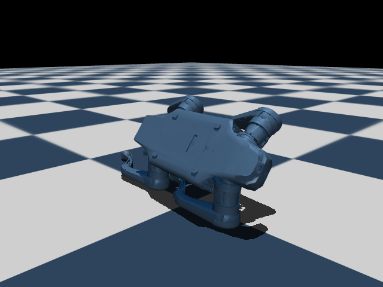

# 仿真可行性预研记录

> 日期：2026-11-19
> 环境：Ubuntu 24.04 / Python 3.12 / MuJoCo 4.0.1 / 官方 Lite3 MJCF（精简网格版）
> 目的：在写正式代码前，确认「模型能站、能摔、能起身、能渲染」，并摸清平台起身能力的边界。

## 1. 环境与模型

- 模型：`sim/models/lite3/Lite3.xml`，12 个力矩电机（±30 N·m），19 个 qpos（7 基座 + 12 关节）；
- 物理步长：1 ms（MJCF 默认 2 ms，脚本中覆盖）；
- 站立参数：官方 `pre_height=0.12 m`、`stand_height=0.33 m`、`kp=100`、`kd=2.5`；
- 站立姿态由官方 IK 公式计算：`HipY=-0.6535`、`Knee=1.2711`（rad）。

## 2. 站立测试

| 项目 | 结果 |
|---|---|
| 目标高度 | 0.33 m |
| 5 s 后实际高度 | 0.345 m（PD 稳态误差约 1.5 cm） |
| roll / pitch 漂移 | < 0.5° |
| 关节最大跟踪误差 | 0.068 rad |
| 离屏渲染 | `MUJOCO_GL=egl` 正常出图（640×480） |

结论：模型与控制链路可用，高度稳态误差需在「起身成功判据」中留容差（当前配置 `±3 cm`）。

## 3. 翻倒与起身边界（关键结论）

把机器人按指定姿态放置（留 5 mm 间隙、零速度、阻尼稳定 1.2 s），再执行官方两阶段站立轨迹：

| 初始姿态 | 稳定后姿态 | 稳定后高度 | 官方站立结果 |
|---|---|---|---|
| 前翻 pitch +90° | 趴地，pitch≈0° | 0.056 m | ✅ 成功，回到 0.346 m |
| 后翻 pitch -60°（近站姿腿） | 后仰约 -25° | 0.346 m | ⚠️ 能起，但未真正翻倒，不算有效摔倒姿态 |
| 后翻 pitch -75° / -90° | 翻成仰面 | 0.073 m | ❌ 失败，停在仰面 |
| 侧翻 roll ±65°（腿伸展：HipY=-1.35, Knee=0.6） | 约 ±55° | 0.175 m | ✅ 成功，回到 0.346 m |
| 侧翻 roll ±45°–±70°（腿收折/外展） | 约 ±59° | 0.177 m | ❌ 失败，停在侧面 |
| 侧翻 roll ±75° / ±90° | 约 ±70°–89° | 0.183 m | ❌ 失败，停在侧面 |
| 仰翻 180° | 仰面 | 0.073 m | ❌ 失败 |
| 小跑中 60 N 侧向冲量 | 约 -57° | 0.176 m | ❌ 失败（落到全侧翻） |

### 解释

1. 官方 `StandUpState` 的轨迹是「从当前关节角插值到预站立蹲姿 → 按高度升到 0.33 m」，**不是通用的自翻正算法**；它假设机器人已经趴在腹部或接近坐姿。
2. 侧躺时能否起身，取决于腿的构型：**腿伸展**（脚能踩到地面）时，站立轨迹的伸腿动作可以把躯干推回来；腿收折/外展时脚没有支点，怎么伸腿都起不来。侧翻 65° + 腿伸展可以稳定在 55° 并成功起身。
3. 一旦机体真正仰面，重力方向与支撑多边形都不在站立轨迹的恢复范围内，单纯对称地伸腿无法把躯干翻回来。
4. 这与任务书的评分设计一致：9 次中允许 3 次失败（合格线 6 次），失败案例本身就是交付内容。

## 4. 对正式测试的决策

- **正式 9 次**按任务书三类各 3 次构造，并按平台包络如实统计：
  - 前翻：pitch +90°（趴地），预计 3/3 起身；
  - 侧翻：roll ±65°、腿伸展（落地约 55°，左右交替），预计 3/3 起身；
  - 后翻：pitch -90°（真正仰翻），预计 0/3 起身；
  - 合计预计 6/9，刚好达到任务书合格线；若实机表现更好，再上调。
- **失败与超时用例**采用全侧翻 90°、仰翻 180°、台阶挡腿，验证 `SAFE_FAULT` 与提示。它们与正式测试的后翻失败不冲突：正式测试只看「是否尝试并安全收尾」。
- 检测阈值：侧翻稳定后约 55°，50° 门限可以直接检出；高度/支撑作为辅助确认，主要用于区分「真实翻倒」与「小跑中的瞬时大姿态」。
- 所有姿态在正式矩阵前先做「纯物理 3 s 稳定性检查」，确保不会自行翻滚。

## 5. 待补实验

- [ ] 用「最低点 + 5 mm 间隙」的规范注入替换当前脚本，固定 9 种姿态参数；
- [ ] 官方 ONNX 策略小跑，测 roll/pitch 包络（用于阈值标定与误报测试）；
- [ ] 5° 斜坡与 0.10 m 台阶场景；
- [ ] 侧翻 65° + 腿伸展的 3 次重复性（落地角、起身成功率）；
- [ ] 视频录制与时间戳同步。

## 6. 对计划的影响

- 仿真必须包含「**可恢复包络筛选**」这一前置步骤，不能假设所有翻倒姿态都能起身；
- 报告要把「平台能力边界」讲清楚：哪些姿态是平台能恢复的，哪些必须走失败/超时路径；
- 目标总分 ≥90：检测、流程、异常、参数四项冲优秀；起身项按 6/9 合格档计 15 分（60%），合计约 90 分。若实机或后续调试能多恢复 2 次，可到 95 分。
