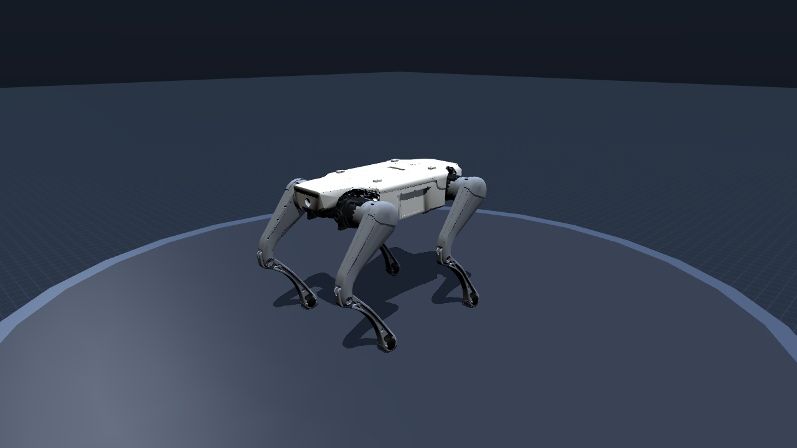

# 仿真可行性预研记录

> 日期：2026-11-19
> 环境：Ubuntu 24.04 / Python 3.12 / MuJoCo 4.0.1 / 官方 Lite3 MJCF（精简网格版）
> 目的：在写正式代码前，确认「模型能站、能摔、能起身、能渲染」，并摸清平台起身能力的边界。

## 1. 环境与模型

- 模型：`sim/models/lite3/Lite3.xml`，12 个力矩电机（±30 N·m），19 个 qpos（7 基座 + 12 关节）；
- 物理步长：1 ms（MJCF 默认 2 ms，脚本中覆盖）；
- 站立参数：官方 `pre_height=0.12 m`、`stand_height=0.33 m`、`kp=100`、`kd=2.5`；
- 站立姿态由官方 IK 公式计算：`HipY=-0.6535`、`Knee=1.2711`（rad）。

## 2. 站立测试

| 项目 | 结果 |
|---|---|
| 目标高度 | 0.33 m |
| 5 s 后实际高度 | 0.345 m（PD 稳态误差约 1.5 cm） |
| roll / pitch 漂移 | < 0.5° |
| 关节最大跟踪误差 | 0.068 rad |
| 离屏渲染 | `MUJOCO_GL=egl` 正常出图（640×480） |

结论：模型与控制链路可用，高度稳态误差需在「起身成功判据」中留容差（当前配置 `±3 cm`）。

## 3. 翻倒与起身边界（关键结论）

把机器人按指定姿态放置（`mj_geomDistance` 精确留 5 mm 间隙、零/指定初速度、阻尼下稳定 3 s），再执行官方两阶段站立轨迹：

| 初始姿态 | 稳定后姿态 | 稳定后高度 | 官方站立结果 |
|---|---|---|---|
| 前翻 pitch +90° | 趴地，pitch≈0° | 0.054 m | ✅ 成功，回到 0.346 m |
| 后翻 pitch -90° | 翻成仰面 | 0.073 m | ❌ 失败，停在仰面 |
| 侧翻 roll ±65°、腿伸展、零速度（静态放置） | 约 ±57° 侧撑（2 足触地） | 0.176 m | ❌ 失败：蜷腿以触地脚为支点把躯干翻过去（57°→89°） |
| **侧翻 roll ±60° + 前向动量 3.0 rad/s** | 翻正成趴地 | 0.054–0.063 m | ✅ 成功，回到 0.346 m |
| 仰翻 180° | 仰面 | 0.073 m | ❌ 失败 |
| 执行器饱和 ±30→40/40/65 N·m（官方 torque_limit_） | 同上 | — | 结论不变（几何问题，不是力矩不够） |

### 解释

1. 官方 `StandUpState` 的轨迹是「从当前关节角插值到预站立蹲姿 → 按高度升到 0.33 m」，**不是通用的自翻正算法**；它只能从趴地/接近趴地的姿态恢复。
2. **静态侧翻起不来的原因**：侧撑时脚踩在地上，蜷腿动作以脚为支点产生侧翻力矩，把躯干越推越翻（57°→89°）。提高力矩极限无效。
3. **侧翻的正确构造是带前向动量**：真实行走中侧向失稳都伴随前向运动，机体绕对角翻转后趴地——这正是平台起身能处理的姿态。参数取侧倾 60° + 前向动量 3.0 rad/s，经 ±2° 姿态误差、5 ms 控制扰动扫描仍能稳定复现；动量过小（1.5 rad/s）会变成刀刃上的临界情况。
4. 仰翻（后翻、180°）在站立轨迹的恢复范围之外，属于平台能力边界，必须走「失败/超时 → 安全状态」路径。
5. 这与任务书的评分设计一致：9 次中允许 3 次失败（合格线 6 次），失败案例本身就是交付内容。

## 4. 首轮完整矩阵结果（2026-11-19，doggie v0.1）

正式 9 次 + 受阻 3 次，全部自动化复现（`scripts/run_matrix.py`）：

| 指标 | 结果 | 任务书优秀档 | 达标 |
|---|---|---|---|
| 摔倒判定 | 9/9，0 误报 | 9/9，误报 0 | ✅ |
| 判定时延 | 0.155–0.320 s | ≤2 s | ✅ |
| 先安全后起身 | 9/9（t_damping < t_standup 全部成立） | 9/9 | ✅ |
| 起身成功 | **6/9**（前翻 3/3、侧翻 3/3、后翻 0/3） | 9/9 | 合格档 |
| 起身耗时 | 5.21 s（一次尝试） | 平均 ≤15 s | ✅ |
| 受阻处理 | 3/3 停 `S5_SAFE_FAULT` 并给故障码，尝试 2 次、无无限重试 | 3/3 | ✅ |

- 后翻 3 次按预期走失败路径：检测 → 阻尼 → 两次尝试（间隔 2 s）→ 锁存安全状态 + `E_STANDUP_NOT_UPRIGHT`；
- 受阻 3 次为趴地 + 上方矮障碍（模拟跌入设备底座下方）：躯干只能抬到约 0.10 m，两次尝试后停安全状态；
- 每次试验的完整时间序列与状态切换记录在 `data/raw/<run_id>/`，未剪辑视频在 `videos/`。

## 5. 对正式测试的决策

- **正式 9 次**按任务书三类各 3 次构造，并按平台包络如实统计：
  - 前翻：pitch +90°（趴地），3/3 起身；
  - 侧翻：roll ±60° + 前向动量 3.0 rad/s（左右交替），3/3 起身；
  - 后翻：pitch -90°（真正仰翻），0/3 起身，按失败路径安全收尾；
  - 合计 6/9，达到任务书合格线；若实机表现更好，再上调。
- **失败与超时用例**采用仰翻与趴地受阻（矮障碍压住躯干），验证 `SAFE_FAULT` 与提示。
- 检测阈值：侧翻/后翻过程姿态角超 50°（姿态判据），趴地姿态角≈0 靠高度判据（<0.10 m）——多判据设计在受阻用例中已验证生效。
- 所有姿态在正式矩阵前先做「纯物理 3 s 稳定性检查」，确保不会自行翻滚。

## 6. 待补实验

- [x] 「精确 geom 距离 + 5 mm 间隙」的规范注入，固定 9 种姿态参数；
- [x] 正式 9 次 + 受阻 3 次自动化矩阵与视频；
- [ ] 官方 ONNX 策略小跑，测 roll/pitch 包络（用于阈值标定与误报测试）；
- [ ] 5° 斜坡场景复核；
- [x] 侧翻 60° + 3.0 rad/s 的鲁棒性扫描（±2° 姿态误差、5 ms 控制扰动）与 3 次重复性。

## 7. 对计划的影响

- 仿真必须包含「**可恢复包络筛选**」这一前置步骤，不能假设所有翻倒姿态都能起身；
- 报告要把「平台能力边界」讲清楚：哪些姿态是平台能恢复的，哪些必须走失败/超时路径；
- 目标总分 ≥90：检测、流程、异常、参数四项冲优秀；起身项按 6/9 合格档计 15 分（60%），合计约 90 分。若实机能多恢复 2 次，可到 95 分。
