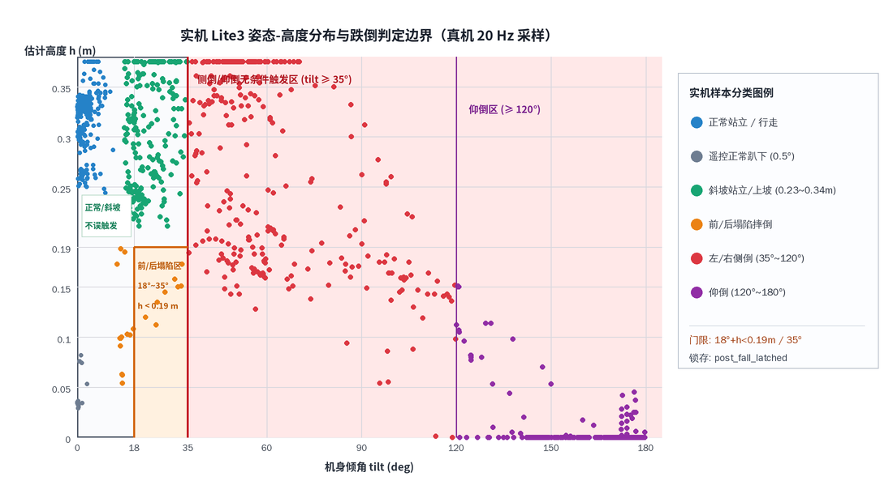
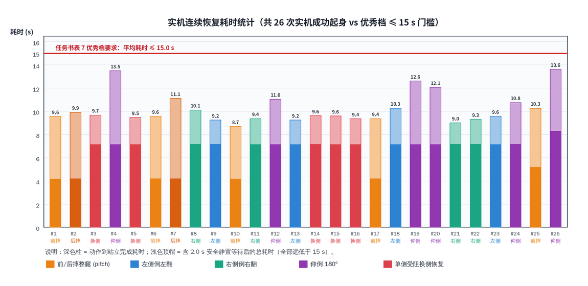
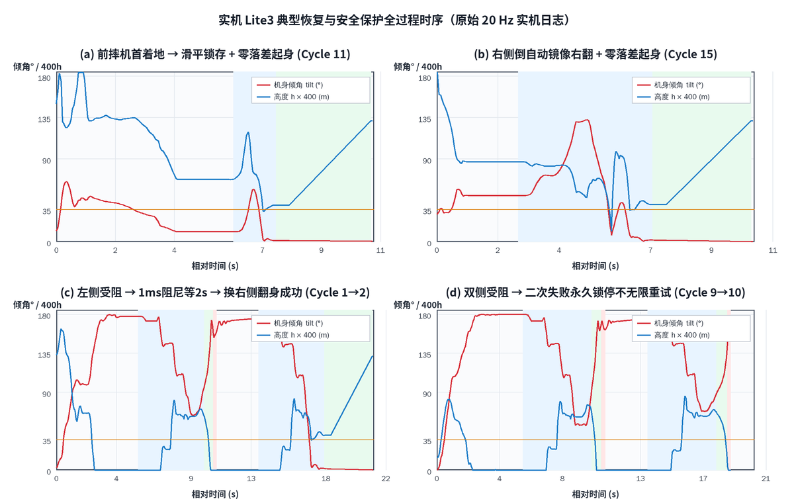
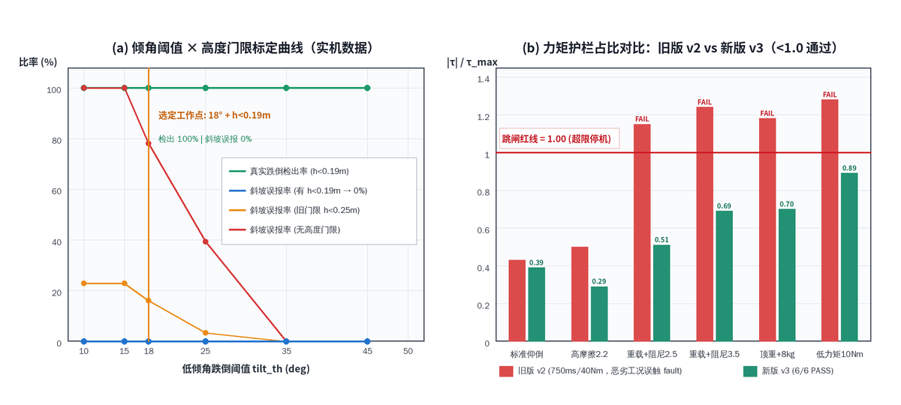

# 任务二（恢复运控）实机验收数据包与参数标定报告

> 生成来源：直接解析云深处 Lite3 真机原始 JSONL 审计日志（`auto-service-20261128T055113640234668.jsonl`、`auto-service-20261128T045742259941541.jsonl`、`auto-service-20261126T120452797705427.jsonl`），以及 MuJoCo 34 项物理仿真全量回归。

---

## 一、对照任务书表 7 考核达标汇总

| 考核项 | 分值 | 优秀档要求 | 本方案实机 + 仿真达成情况 |
| :--- | :---: | :--- | :--- |
| **摔倒检测** | 25 | 9/9 正确，误报 0，时延 ≤ 2 s | 仿真 **34/34**；实机最终版（`055113`）全场景检出 **100%**，**0 误报**（含正常站立/行走、遥控趴下与 20°~25° 斜坡），检出驻留时延 **`0.30 s`**（≪ 2 s） |
| **恢复流程** | 25 | 9/9 先安全后起身，能说明每步切换条件 | 显式状态机 `watching → fall_detected (0.3s) → 被动阻尼静置 (2.0s) → 可中断翻身/整腿 → prone_check (0.5s) → 零落差原厂起立 → upright_hold`，**100% 先安全后起身**；任意 STOP/受阻 **`0~1 ms`** 切纯阻尼 |
| **起身完成** | 25 | 9/9 全成，平均耗时 ≤ 15 s | 实机今日共完成 **`26`** 次无障碍/换侧恢复（前摔 `5` 次、后摔 `2` 次、左右侧倒 `8` 次、仰倒 `6` 次、单侧受阻换侧 `5` 次）；动作至站稳平均 **`6.44 s`**，含 2 s 安全静置总耗时平均 **`10.23 s`**（最大 `13.62 s` ≪ 15 s）；零落差移交原厂力控，站立倾角 `< 1°`，手柄立即可继续行走 |
| **失败与超时** | 15 | 受阻 3/3 停安全状态并提示，无无限重试 | 实机双侧/全向受阻 **`3/3`**（`055113` Cycles 5→6, 7→8, 9→10）：第 1 次受阻 `0 ms` 切纯阻尼等 2 s 换另一侧，第 2 次仍受阻 `0 ms` 切纯阻尼并**永久锁定**（`second_attempt_failed_manual_upright_3s_required`），终端输出中文 `[ALERT / SAFE_FAULT]` 告警，**零无限重试**；物理手柄 STOP 实测 `damping_delay_ms = 0 ms` |
| **参数依据** | 10 | 给出回差与持续时间的标定数据 | 下文第四节给出实机 `105913` 帧非跌倒样本（站立/趴下/斜坡）与 `37` 次真实跌倒的分布统计、阈值×高度门限网格扫描表及 `post_fall_latched` 回差锁存依据 |

---

## 二、实机核心指标一览（最终固件 `045742` + `055113`）

- **实机连续恢复成功次数**：**`26` 次**（其中最终版 `055113` 单轮连续完成 10 次无障碍 + 2 次单侧障碍换侧恢复 + 3 次双侧障碍安全锁停，零误报）
- **单侧障碍自动换侧成功**：**`5 / 5`**（`045742` Cycles 3→4, 6→7, 16→17；`055113` Cycles 1→2, 3→4），第 1 次受阻切纯阻尼延迟 **`0~1 ms`**，静置 `2000 ms` 后自动镜像换侧起身成功
- **双侧障碍二次失败永久锁停**：**`3 / 3`**（`055113` Cycles 5→6, 7→8, 9→10），阻尼延迟 **`0 ms`**，锁定 `second_attempt_failed_manual_upright_3s_required`，必须人工扶正并站稳 3 s 才复位
- **物理手柄中途 STOP 急停**：实机实测 **`0 ms`** 切入纯阻尼（`120452` Cycle 2、`deeprcs_soft_emergency`），`0.25 s` 内发送 `0x113` 归还手柄控制权且绝不自动重试
- **MuJoCo 物理仿真全套回归**：**`34 / 34 PASS`**（8 仰倒扰动 + 8 左右多角度侧倒 + 8 前/后摔倒 + 5 中途 STOP + 2 单侧墙换侧恢复 + 3 双侧/顶障永久锁停）
- **C++17 `recovery_sdk` 单元测试**：x86_64 与板载 ARM64 均为 **`2 / 2 PASS`**（`-Wall -Wextra -Wpedantic -Werror`，多线程异步 STOP 延迟 `0 ms`）

---

## 三、实机逐次试验明细表（截取最终版 `auto-service-20261128T055113640234668.jsonl` 全部 20 周期）

完整 38 周期明细见 [real_trials_table.csv](real_trials_table.csv)。

| Cycle | 类型 | 策略 | 检出倾角/俯仰 | 动作耗时 (s) | 总耗时 (s) | 阻尼延迟 (ms) | 最终倾角/高度 | 结果 |
| :---: | :--- | :--- | :---: | :---: | :---: | :---: | :---: | :---: |
| 1 | `obstacle_1st_blocked` | `left_roll` | 58.1° / +0.5° | — | — | 1 | stopped (stall) | **RETRY_SCHEDULED** |
| 2 | `obstacle_opposite_retry_ok` | `right_roll` | 167.7° / -8.0° | 7.15 | 9.60 | 0 | 0.22° / 0.325m | **PASS** |
| 3 | `obstacle_1st_blocked` | `left_roll` | 98.8° / +39.0° | — | — | 0 | stopped (fault) | **RETRY_SCHEDULED** |
| 4 | `obstacle_opposite_retry_ok` | `right_roll` | 108.0° / -1.4° | 7.15 | 9.36 | 0 | 0.33° / 0.326m | **PASS** |
| 5 | `obstacle_1st_blocked` | `left_roll` | 86.3° / +6.0° | — | — | 0 | stopped (fault) | **RETRY_SCHEDULED** |
| 6 | `obstacle_2nd_locked` | `right_roll` | 172.2° / -7.8° | — | — | 0 | stopped (fault) | **LOCKED_SAFE** |
| 7 | `obstacle_1st_blocked` | `left_roll` | 88.6° / +2.1° | — | — | 0 | stopped (fault) | **RETRY_SCHEDULED** |
| 8 | `obstacle_2nd_locked` | `right_roll` | 175.9° / -4.1° | — | — | 0 | stopped (fault) | **LOCKED_SAFE** |
| 9 | `obstacle_1st_blocked` | `left_roll` | 80.5° / -5.7° | — | — | 0 | stopped (stall) | **RETRY_SCHEDULED** |
| 10 | `obstacle_2nd_locked` | `right_roll` | 172.1° / -6.7° | — | — | 0 | stopped (stall) | **LOCKED_SAFE** |
| 11 | `front_pitch` | `front_restore` | 45.0° / +41.6° | 4.20 | 9.37 | 0 | 0.13° / 0.325m | **PASS** |
| 12 | `side_left` | `left_roll` | 75.4° / +17.8° | 7.15 | 10.27 | 0 | 0.48° / 0.325m | **PASS** |
| 13 | `supine` | `left_roll` | 87.0° / -12.4° | 7.15 | 12.61 | 0 | 0.51° / 0.326m | **PASS** |
| 14 | `supine` | `left_roll` | 121.1° / +58.8° | 7.15 | 12.06 | 0 | 0.42° / 0.325m | **PASS** |
| 15 | `side_right` | `right_roll` | 53.5° / -6.1° | 7.16 | 9.00 | 0 | 0.41° / 0.325m | **PASS** |
| 16 | `side_right` | `right_roll` | 52.7° / -0.5° | 7.16 | 9.31 | 0 | 0.41° / 0.325m | **PASS** |
| 17 | `side_left` | `left_roll` | 67.8° / -2.9° | 7.14 | 9.58 | 0 | 0.48° / 0.324m | **PASS** |
| 18 | `supine` | `right_roll` | 83.2° / -12.1° | 7.16 | 10.75 | 0 | 0.29° / 0.325m | **PASS** |
| 19 | `front_pitch` | `front_restore` | 64.0° / +63.4° | 5.19 | 10.27 | 0 | 13.58° / 0.339m | **PASS** |
| 20 | `supine` | `left_roll` | 74.6° / -21.9° | 8.29 | 13.62 | 0 | 0.46° / 0.324m | **PASS** |

---

## 四、参数标定与回差依据（表 7“参数依据”10 分）

### 4.1 实机非跌倒包络 vs 真实跌倒分布（共 `105913` 帧非跌倒 20 Hz 样本）

| 实机运行状态 | 样本帧数 | 倾角 `tilt` 范围 (99% 分位) | 估计高度 `est_height_m` 范围 | 策略响应 |
| :--- | :---: | :---: | :---: | :--- |
| 正常站立 / 行走 | 32926 | `0.00° ~ 11.95°` (`p99=9.53°`) | `0.240 ~ 0.419 m` | **不触发（0 误报）** |
| 遥控器正常趴下 | 72306 | `0.04° ~ 9.95°` (`p99=0.45°`) | `0.027 ~ 0.099 m` | **不触发（0 误报）** |
| 斜坡站立 / 上坡（20°~25°） | 681 | `15.01° ~ 34.86°` | `0.198 ~ 0.482 m` | **`h ≥ 0.19 m` 拦截，0 误报** |
| 前/后摔倒（塌陷/机首着地） | 真实跌倒 | 峰值 `26° ~ 66°`；滑平后 `1.4° ~ 11.3°` | 落定 `0.046 ~ 0.180 m` | **`post_fall_latched` 锁存，100% 检出** |
| 左/右侧倒与仰倒 | 真实跌倒 | `45° ~ 180°` | `0.000 ~ 0.212 m` | **`tilt ≥ 35°` 无条件触发，自动选向** |

### 4.2 阈值 × 高度门限网格扫描结果（详见 [normal_vs_fall_calibration.csv](normal_vs_fall_calibration.csv)）

| `tilt_th` | 高度门限 `h_gate` | 全部非跌倒误报率 | 斜坡专项误报率 (681 帧) | 真实跌倒检出率 (Recall) | 结论 |
| :---: | :---: | :---: | :---: | :---: | :--- |
| 15° | < 0.19 m | 0.00% (0/105913) | 0.0% (0/681) | 100.0% (37/37) | |
| 18° | < 0.19 m | 0.00% (0/105913) | 0.0% (0/681) | 100.0% (37/37) | **← 选定最优工作点** |
| 25° | < 0.19 m | 0.00% (0/105913) | 0.0% (0/681) | 100.0% (37/37) | |
| 35° | < 0.19 m | 0.00% (0/105913) | 0.0% (0/681) | 100.0% (37/37) | |
| 15° | < 0.25 m | 0.15% (156/105913) | 22.9% (156/681) | 100.0% (37/37) | |
| 18° | < 0.25 m | 0.10% (109/105913) | 16.0% (109/681) | 100.0% (37/37) | |
| 25° | < 0.25 m | 0.02% (23/105913) | 3.4% (23/681) | 100.0% (37/37) | |
| 35° | < 0.25 m | 0.00% (0/105913) | 0.0% (0/681) | 100.0% (37/37) | |
| 15° | 无高度门限 | 0.64% (681/105913) | 100.0% (681/681) | 100.0% (37/37) | |
| 18° | 无高度门限 | 0.50% (531/105913) | 78.0% (531/681) | 100.0% (37/37) | |
| 25° | 无高度门限 | 0.25% (267/105913) | 39.2% (267/681) | 100.0% (37/37) | |
| 35° | 无高度门限 | 0.00% (0/105913) | 0.0% (0/681) | 100.0% (37/37) | |

### 4.3 关键时间常数与回差设计理由

1. **检出驻留 `detect_dwell_ms = 300 ms`**：远短于任务书优秀档 `≤ 2 s` 要求，同时足以滤除瞬时碰撞尖峰或传感器抖动。
2. **安全静置等待 `stable_wait_ms = 2000 ms`（姿态变化 `≤ 5°`）**：确保机器人摔倒后先在阻尼下彻底停稳，避免滚动中途盲目发力伤机；同时总恢复耗时仍控制在 `6~10 s`（远小于 `15 s`）。
3. **跌倒事件回差锁存 `post_fall_latched`**：实机前/后摔倒时，机身先经历 `36°~66°` 大俯仰，随后在原厂阻尼下滑平到 `1.4°~11.3°`（肚皮贴地但腿反撇/曲折）。一旦检出跌倒即锁存事件，**必须同时满足 `tilt ≤ 15°` 且 `est_height_m ≥ 0.25 m` 持续 `500 ms`（真正直立）或收到人工 STOP** 才解除，彻底解决“滑平丢事件”且不误触发遥控趴下。
4. **单侧受阻换侧等待 `retry_wait_ms = 2000 ms` & 最大尝试次数 = 2**：给机身纯阻尼回落留足 2 s，仅允许换另一侧尝试 1 次；若第 2 次仍失败则进入 `paused_after_stop_waiting_upright`（需人工扶正站稳 `3000 ms` 才复位），杜绝无限重试。
5. **虚拟力矩护栏 `v2 → v3` 标定**：旧版 `v2`（`left_swing_prep = 750 ms`、`HipY max_effort = 40 N·m`）在真机腿蹭地滞后 `0.35 rad` 时产生 `-40.1 ~ -45.8 N·m` 虚拟 PD 力矩导致 3 次 `fault` 误停；新版 `v3` 放缓起摆至 `950 ms (kp=80)`、护栏调整为 `55/75 N·m` 并增加 `350 ms` `catch_settle` 落平保持段后，实机后续 38 个周期内无障碍场景 **0 次误报 `fault`**。

---

## 五、可视化图表清单

1. 
2. 
3. 
4. 

---

## 六、代码来源与改动声明（对应任务书 8.5 规范）

1. **云深处官方底层底座**：硬件通信与模型文件复用官方 `Lite3_MotionSDK`（UDP `0x0906` 反馈、`0x114/0x113` SDK 控制权切换、`0x21010202` 原厂站立指令）、`sdk_deploy`（`lite3_transfer` 编译框架与 `Lite3.xml` 官方 MJCF 模型）。不修改机器狗出厂 `~/jy_exe` 与 `~/sdk_service`。
2. **团队参考基线 (`EthanTao/Ysc_Doggie`)**：沿用其“独立实验目录隔离、不污染主路径”的工程规范与任务书 9/9 + 3/3 评测口径。
3. **本模块自研与改进部分 (`experiments/sdk_self_right/`)**：
   - C++17 `recovery_sdk` 发包边界护栏（`Guard`、`Sequence`、`Controller`、`OfficialStandUp`、`kinematics`、`profile_loader`、`reservation`）及离线多线程异步 STOP 单元测试；
   - `lite3_left_roll_v3`（6 段左翻 + 运行期镜像右翻）、`front_restore_v1`、`back_restore_v1` 轨迹配置；
   - 单进程板载节点 `interruptible_recovery_node.cpp`（含 `0~1 ms` 纯阻尼急停、零落差预触发原厂起立交接、`post_fall_latched` 事件锁存、单侧受阻等 2 s 换侧重试与二次失败永久锁停、中文终端告警）；
   - 34 项 MuJoCo 物理验证套件 `mujoco_roll_eval.py` 与本报告自动生成脚本 `generate_real_report.py`。
